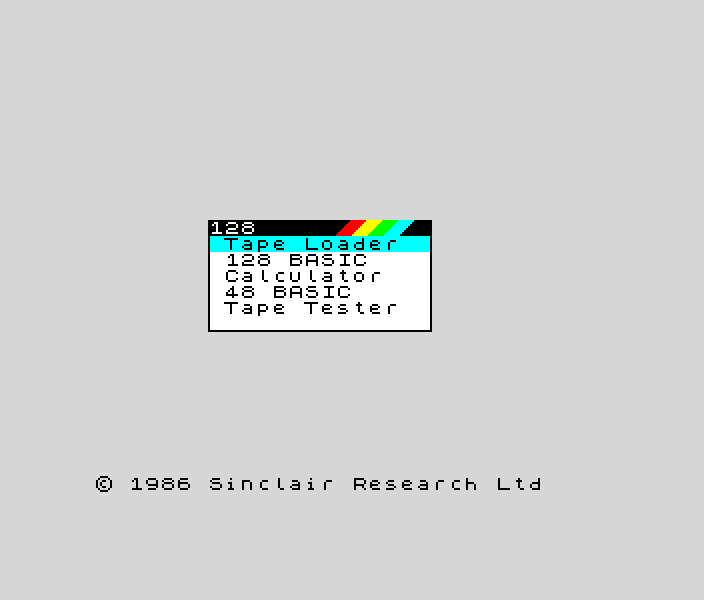
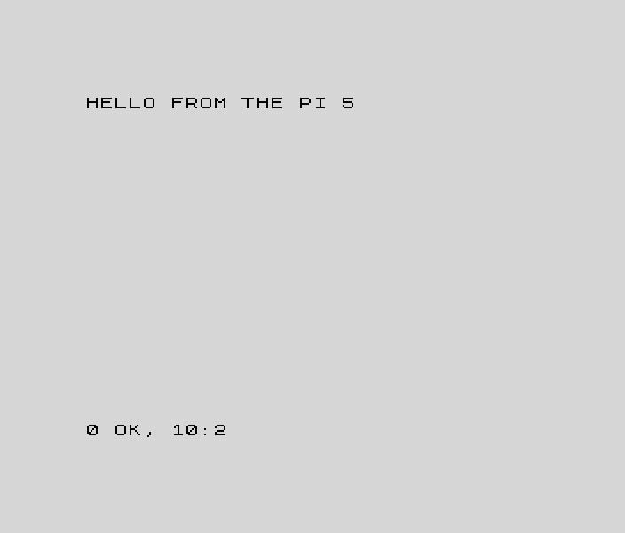
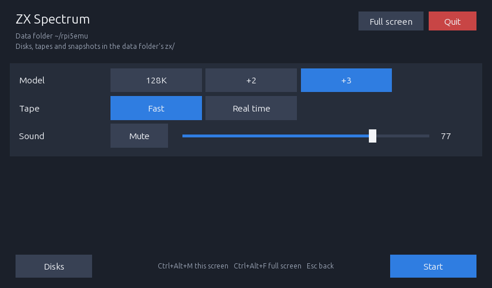
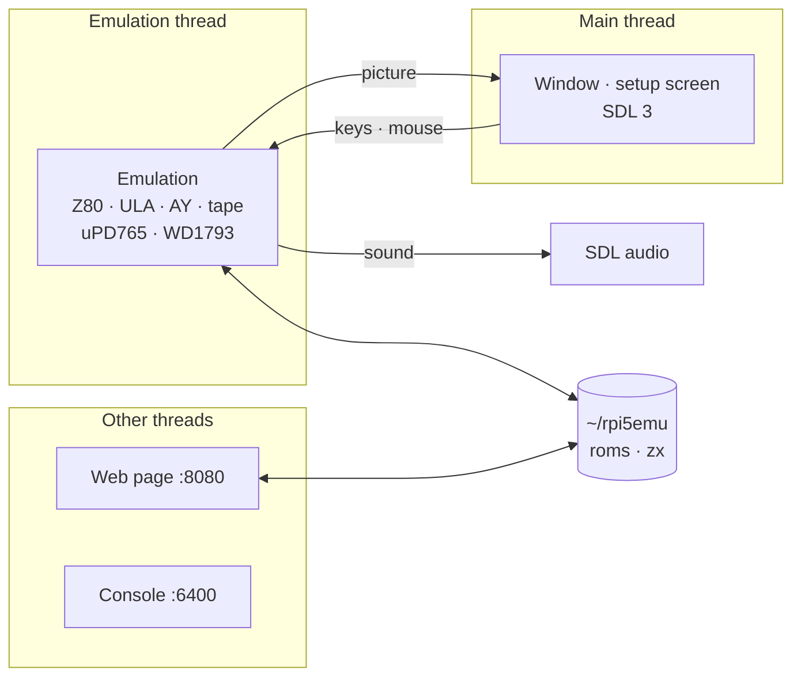

<h1 align="center">rpi5zx</h1>

<p align="center">
  <b>A ZX Spectrum 128K, +2 or +3 on the Raspberry Pi 5, in a window of its own.</b><br>
  Z80 with the ULA's contention, AY sound, tapes that load at once, the +3's disks and a Beta 128 (TR-DOS) on the 128K and +2.
</p>

<p align="center">
  
  
  
  
  
</p>

<p align="center">
  <b>Work in progress:</b> not everything has been tested, and games and demos may or may not
  work satisfactorily.
</p>

<p align="center">
  
  
  <br>
  <sub>The Spectrum 128's start-up menu and a line run in 128 BASIC, on the Pi. Every pixel shown twice in each direction, border included.</sub>
</p>

rpi5zx runs [esp32zx](https://github.com/rlucencic/esp32zx)'s Spectrum on a Raspberry Pi 5 with
64-bit Linux, in a window of its own (X11 or Wayland, through SDL 3). The machine is the
same code as on the ESP32 boards: esp32zx's platform-independent core and
[esp32emu](https://github.com/rlucencic/esp32emu)'s CPU core, on
[rpi5emu](https://github.com/rlucencic/rpi5emu), the family's Linux runtime: a setup
screen in the window, sound, the Pi's keyboard and mouse, a web page on your network and a
console.

It's one of the rpi5 family, the Raspberry Pi versions of the esp32 emulators:
[rpi5cpc](https://github.com/rlucencic/rpi5cpc) (Amstrad CPC),
[rpi5cbm](https://github.com/rlucencic/rpi5cbm) (Commodore 64 and 128),
[rpi5coco](https://github.com/rlucencic/rpi5coco) (Tandy Color Computer 2 and 3),
[rpi5gs](https://github.com/rlucencic/rpi5gs) (Apple IIGS),
[rpi5msx](https://github.com/rlucencic/rpi5msx) (MSX1 and MSX2),
[rpi5xl](https://github.com/rlucencic/rpi5xl) (Atari 800XL and 130XE),
[rpi5ste](https://github.com/rlucencic/rpi5ste) (Atari STE),
[rpi5pc](https://github.com/rlucencic/rpi5pc) (IBM PC/XT and PC/AT),
[rpi5mac](https://github.com/rlucencic/rpi5mac) (Macintosh Plus, SE, Classic),
[rpi5mac2](https://github.com/rlucencic/rpi5mac2) (Macintosh LC and II),
[rpi5mac3](https://github.com/rlucencic/rpi5mac3) (Macintosh LC II and LC III),
[rpi5arc](https://github.com/rlucencic/rpi5arc) (Acorn Archimedes),
[rpi5ami](https://github.com/rlucencic/rpi5ami) (Amiga 500, 2000, 600, 1200).

## Features

**The machine**
- **Three models**, chosen on the setup screen: the Sinclair ZX Spectrum 128,
  the Amstrad +2 (grey) and the +3, each with its own ROMs and 128 KB
- 128 BASIC, 48 BASIC, +3 BASIC and +3DOS, TR-DOS, from the original ROMs
- Z80 that passes zexall, in T-states with the ULA's memory and I/O
  contention (128K and +3 patterns), 50 Hz interrupt; border colour changes
  land on the right pixel, paper lines are drawn as the beam reaches them
- 128K paging (`$7FFD`) and the +3's all-RAM modes (`$1FFD`), shadow screen
- AY-3-8912 and the beeper, mixed on the speaker (and the tape's sound)
- Kempston, Sinclair or cursor joystick on the numeric keypad

**Tapes**
- **`.TAP` and `.TZX`** (standard, turbo, pure tone, pulses, pure data,
  direct recording, generalized data, pauses, loops, jumps)
- **Fast loading**: standard blocks load at once through the ROM's loader;
  turbo and custom loaders play in real time, started when a loader reads
  the tape (and loaders built on the ROM's edge loop run about twice as fast)
- `SAVE` writes into an inserted `.TAP`; a new empty tape is one tap away
- Protected tapes load: Speedlock 2 and 4, Hewson's loaders and others

**Disks**
- **+3**: its own uPD765 with `.DSK` images (standard and extended,
  esp32emu's controller, shared with the CPC), drives A: and B:
- **128K and +2**: a **Beta 128** interface (WD1793, TR-DOS 5.04T) with
  `.TRD` images and `.SCL` archives (read-only), drives A: and B:; a disk in
  A: boots TR-DOS
- **New blank disks**, formatted for the model: 640 KB TR-DOS or 173 KB +3
- Disk writes go back to the data folder a second after they happen

**Snapshots**
- **`.SNA`** (48K and 128K) and **`.Z80`** (versions 1 to 3, compressed or
  not); a 48K snapshot runs in 48K mode

**Around it**
- **A window** of its own on the Pi's desktop (X11 or Wayland), resizable, full screen
  with Ctrl+Alt+F; the picture in the machine's shape, sharp pixels
- **Setup screen** in the window, first thing at start and any time with Ctrl+Alt+M:
  model, tape speed, the sound's volume, the drives and their images (insert, eject, new
  blank ones), Start / Back / Restart, Reset
- **The Pi's keyboard and mouse**: keys by position, as the boards' Bluetooth keyboards;
  a click in the window gives the mouse to the machine, Ctrl+Alt+G takes it back
- **Web page** at `http://<the Pi>:8080/`: drop images (or ZIP files) onto it, insert
  them, make blank ones, and watch the machine and its drives live
- **Sound** through SDL (PipeWire, PulseAudio or ALSA), the machine paced by the clock
- **Console** on the terminal and on `127.0.0.1:6400`: keys, typing, drives, screenshots

<p align="center">
  
  <br><sub>The setup screen in the window, before the Spectrum starts</sub>
</p>

## Getting started

### 1. What you need

- A Raspberry Pi 5 with 64-bit Linux (developed on Ubuntu 26.04; any Linux with SDL 3.2 or
  later should do)
- The tools and libraries:
  `sudo apt install build-essential cmake ninja-build pkg-config libsdl3-dev libsdl3-ttf-dev libpng-dev`
- [esp32emu](https://github.com/rlucencic/esp32emu), [rpi5emu](https://github.com/rlucencic/rpi5emu)
  and [esp32zx](https://github.com/rlucencic/esp32zx), cloned next to this project
- The ROMs (below)

### 2. Build

```sh
git clone https://github.com/rlucencic/esp32emu.git
git clone https://github.com/rlucencic/rpi5emu.git
git clone https://github.com/rlucencic/esp32zx.git
git clone https://github.com/rlucencic/rpi5zx.git && cd rpi5zx
cmake -S . -B build -G Ninja && cmake --build build
```

### 3. ROMs

`128.rom` (32 KB), `plus2.rom` (32 KB), `plus3.rom` (64 KB) and, for the
Beta 128's disks, `trdos.rom` (16 KB) in the data folder's `roms/`
(`~/rpi5emu/roms`). Not part of this repository.

### 4. First start

1. `build/rpi5zx`: the setup screen opens in a window.
2. Choose the model and click **Start**.
3. Put images into `~/rpi5emu/zx/`, drop them on the window or the web page, and
   insert them on the setup screen's **Disks** page.

## Using it

| To | Do |
|---|---|
| Get back to the setup screen | Ctrl+Alt+M (the machine waits meanwhile) |
| Full screen | Ctrl+Alt+F |
| Give the mouse to the machine, take it back | A click in the window; Ctrl+Alt+G |
| Run as fast as it goes (warp) | Ctrl+Alt+W, again for real speed |
| Take a screenshot | Ctrl+Alt+S (into `~/rpi5emu/screenshots`), or the console's `s` |
| Insert an image | The setup screen's **Disks** page, drop it on the window or the web page, or name it on the command line: `build/rpi5zx game.tzx` |
| Start straight into the machine | `build/rpi5zx -S`, with the setup screen's rows as `--choice`: `build/rpi5zx -S --choice Model=+3` |
| Show the window on another computer | Log in with `ssh -C -Y <the Pi>` and start it there: fine for still pictures; games want the Pi's own monitor |
| Load a tape | Insert it into **Tape**, then **Tape Loader** in the menu, or `LOAD ""` |
| Save to tape | Insert a `.TAP` (**New** makes an empty one), then `SAVE "name"` |
| Use a +3 disk | Insert the `.DSK` into **A:** on the +3: **Loader** in the menu boots it; `CAT`, `LOAD "name"` |
| Use a TR-DOS disk | Insert the `.TRD`/`.SCL` into **A:** on the 128K or +2 and reset: TR-DOS starts (`RUN` runs its boot file, `LIST` shows the catalogue); from BASIC, `RANDOMIZE USR 15616` |
| Load a snapshot | Insert the `.SNA`/`.Z80` into **Snapshot**: it starts at once (and again when the Spectrum is restarted) |

Images live in `~/rpi5emu/zx/`, settings in `~/.config/rpi5emu/settings.ini`; the
inserted images are remembered across starts. `build/rpi5zx --help` lists the options.

**Keyboard**: letters, digits, Enter and Space as on the Spectrum; Shift is
CAPS SHIFT, Ctrl and Alt are SYMBOL SHIFT. Backspace is DELETE, the cursor
keys are CAPS SHIFT + 5–8, Esc is BREAK, Caps Lock is CAPS LOCK, Tab is
EXTEND MODE. Punctuation keys type their character (`;` is SYMBOL SHIFT + O,
and so on). F9 starts or stops the tape, F10 rewinds it.

**Joystick**: the numeric keypad (8 4 6 2 and the diagonals, 5 or 0 fire).
F11 switches it between Kempston, Sinclair (keys 6–0) and cursor (5–8, 0);
F12 makes the cursor keys the joystick as well, with Alt as fire.

## How it works



- **[esp32zx](https://github.com/rlucencic/esp32zx)'s `components/zx`**: the Spectrum,
  platform independent: the same code runs on the ESP32 boards.
- **`src/`**: the glue, esp32zx's `main/main.c` ported: memory, ROMs, settings, keyboard map,
  drives and status.
- **[rpi5emu](https://github.com/rlucencic/rpi5emu)**: the window, the setup screen, sound,
  input, the web page, the console, the data folder and the settings.
- **[esp32emu](https://github.com/rlucencic/esp32emu)**: the CPU core (Z80).

## Development

```sh
../rpi5emu/tools/pi.sh rpi5zx build        # from another computer: sync to the Pi, build there
../rpi5emu/tools/pi.sh rpi5zx run          # its window on this computer (ssh -C -Y)
../rpi5emu/tools/pi.sh rpi5zx headless     # no window: drive it through the console
../rpi5emu/tools/console.sh i 's /tmp/shot.png'
```

`CLAUDE.md` has the details: the layout, how it was ported, the checks; esp32zx's own
`CLAUDE.md` has the machine's.

## Limitations

- Checked on the Pi through its console and screenshots: the 128 and +3 at full speed; 128 BASIC typed into and run (PRINT, BEEP); a program saved to a new +3 disk and found in the image; the setup screen and the web page. Not yet by hand
  in the window, with the sound heard, or with much software.
- Over X forwarding (`ssh -Y`) every changed picture crosses the network: 8 to 15 a second.
- No 48K or 16K model (48K software runs in 48 BASIC or from 48K
  snapshots), no Pentagon or other clones, no Interface 1, Microdrive or
  printer.
- Contention is per memory access, without the internal cycles between
  them: multicolour engines that count every T-state may be a little off.
  Changes to the screen within a line show from the next line.
- The floppy controllers have no rotation timing (the WD1793's index pulse
  aside): disk protections that measure it fail. `.SCL` is read-only.
- No `.STX`/`.CSW` tapes; TZX CSW blocks are skipped.

## Credits

- [Fuse](https://fuse-emulator.sourceforge.net/) and libspectrum, the
  [World of Spectrum](https://worldofspectrum.org) technical pages and the
  TZX specification: the references for how the Spectrum, its tapes and the
  Beta 128 behave
- The zexdoc/zexall Z80 exercisers by Frank Cringle
- [SDL](https://libsdl.org) 3 for the window, the sound and the input

## Licence

[MIT](LICENSE).

Sinclair, ZX Spectrum and Amstrad are trademarks of their owners. The ROM
images are not part of this repository.
